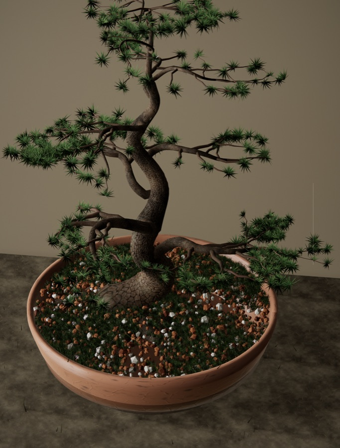
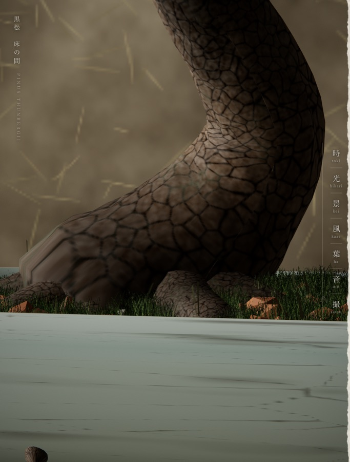

# 黒松盆栽 · Black Pine Bonsai Diorama

仿作，原版出处在这里：https://x.com/majidmanzarpour/status/2081103577590718865

一盆黒松（Pinus thunbergii）摆在干净的摄影棚里——全部由代码生成：虬曲盘干、鳞片树皮、云片针叶、苔藓土丘、圆卵石、红陶浅盆，没有一个外部模型资产。单 HTML 文件，依赖仅 CDN 上的 three.js。

**在线预览：** [https://alun1991.github.io/3d-bonsai/](https://alun1991.github.io/3d-bonsai/)



## 细节

| | |
|---|---|
|  |  |
| 针叶簇成团，条条针叶逐一建模 | 龟甲鳞片树皮，树根扎进苔藓土丘 |

## 交互

- **拖拽** 环绕、**滚轮** 缩放、**单击** 对焦（静止构图，无自动运镜）
- 右侧菜单（仅显示墨点，打开后可见选项）：
  - **時** 朝 / 昼 / 夕 / 夜 四个光照时段（两秒贯通渐变）
  - **光** 曝光、环境光、阴影柔度
  - **景** 景深开关、光圈、焦段（60–135mm）、颗粒、开场运镜、拉焦、重置构图
  - **風** 枝条呼吸幅度
  - **葉** 松针飘落速率、清扫落针
  - **音** 环境声（默认关）
  - **撮** 纯净模式（只剩画面）
- 快捷键：`F` 纯净模式 · `R` 重置构图 · `空格` 拉焦 · `M` 声音 · `D` 景深 · `1–4` 光照预设 · `Esc` 关闭菜单

## 运行

任意静态文件服务器即可（需 WebGL2）：

```bash
cd 3d-bonsai
python3 -m http.server 5173
# 打开 http://localhost:5173/index.html
```

## 文件说明

| 文件 | 说明 |
|---|---|
| `index.html` | 当前版本，单文件完整场景（过程化网格 + 程序化贴图 + 光照烘焙 + 后处理） |
| `index-procedural.html` | 早期过程式版本（樱花） |
| `index-gltf-version.html` | glTF 模型加载版本（依赖 `assets/`） |
| `assets/` | `bonsai.glb` 与 PBR 贴图（仅 glTF 版本使用） |
| `blender/build_bonsai.py` | Blender 场景生成脚本 |

## 技术要点

- 树干/根系为参数化扫掠管体，UV 按管面展开，树皮为噪声烘焙的可平铺鳞片/颜色贴图（Worley 龟裂）
- 针叶簇是真实几何：每簇 26 根细长锥形针叶从枝端放射上扬，逐簇摆动
- 花盆为圆盆截面旋转体，红陶釉纹；土床为隆起圆丘，苔藓铺面，圆卵石嵌入
- 光照为解析矩形光源 + 单次反弹辐射度求解，SH9 环境光与立方体反射贴图均在 CPU 预烘焙，切换时段无跳变
- 后处理：景深（按真实薄透镜圆 CoC 求解）、双滤波泛光、红移光晕、胶片颗粒
- 风场统一由一个 `breathField(世界坐标, 权重)` 函数驱动，所有材质共享，摆角连续不裂
