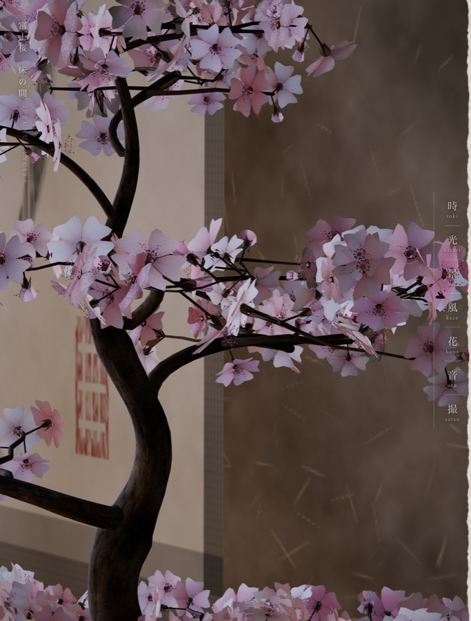

# 床の間 — 富士桜盆栽 · Sakura Bonsai Diorama

一盆富士桜（Prunus incisa 'Kojo-no-mai'）摆进一间床の間——全部由代码生成：树干、花、苔藓、花盆、光影，没有一个外部模型资产。单 HTML 文件，依赖仅 CDN 上的 three.js。

**在线预览：** [https://alun1991.github.io/3d-bonsai/](https://alun1991.github.io/3d-bonsai/)


## 细节

| | |
|---|---|
|  |  |
| 花团大中小错落，五瓣带缺刻的花瓣逐一建模 | 树根扎进土里，苔藓铺满盆面，落花安静堆积 |

## 交互

- **拖拽** 环绕、**滚轮** 缩放、**单击** 对焦
- 右侧菜单：
  - **時** 朝 / 昼 / 夕 / 夜 四个光照时段（两秒贯通渐变）
  - **光** 曝光、环境光、阴影柔度
  - **景** 景深开关、光圈、焦段（60–135mm）、颗粒、开场运镜序列、拉焦、重置构图
  - **風** 枝条呼吸幅度
  - **花** 花瓣飘落速率、清扫落花
  - **音** 环境声（默认关）
  - **撮** 纯净模式（只剩画面）
- 快捷键：`F` 纯净模式 · `R` 重置构图 · `空格` 拉焦 · `M` 声音 · `D` 景深 · `1–4` 光照预设 · `Esc` 关闭菜单

## 运行

任意静态文件服务器即可（需 WebGL2）：

```bash
cd 3d-bonsai
python3 -m http.server 5173
# 打开 http://localhost:5173/index.html
```

## 文件说明

| 文件 | 说明 |
|---|---|
| `index.html` | 当前版本，单文件完整场景（过程化网格 + 程序化贴图 + 光照烘焙 + 后处理） |
| `index-procedural.html` | 早期过程式版本 |
| `index-gltf-version.html` | glTF 模型加载版本（依赖 `assets/`） |
| `assets/` | `bonsai.glb` 与 PBR 贴图（仅 glTF 版本使用） |
| `blender/build_bonsai.py` | Blender 场景生成脚本 |

## 技术要点

- 树干/根系为参数化扫掠管体，UV 按管面展开，树皮为噪声烘焙的可平铺高度/颜色贴图
- 花朵是真实几何：五片带缺刻花瓣 + 十字面片雄蕊群 + 萼片 + 花托 + 花梗，花苞/盛开/凋谢为顶点着色器形变
- 光照为解析矩形光源 + 单次反弹辐射度求解，SH9 环境光与立方体反射贴图均在 CPU 预烘焙，切换时段无跳变
- 后处理：景深（按真实薄透镜圆 CoC 求解）、双滤波泛光、红移光晕、胶片颗粒
- 风场统一由一个 `breathField(世界坐标, 权重)` 函数驱动，所有材质共享，摆角连续不裂
